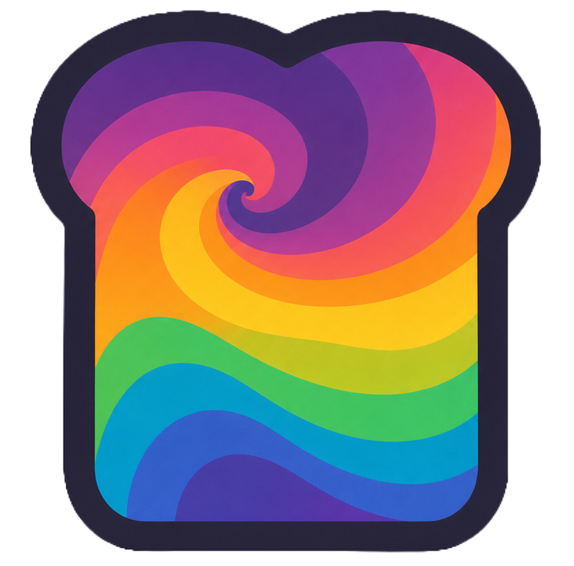

<div align="center">

<h1>


# toast

</h1>
</div>


toast is a beautiful developer environment right in your terminal. vim, nvim, and emacs have you build your editor from scratch, while toast ships with managed LSPs, an integrated file tree, multiple file tabs, and themes out of the box. toast is for the developer who wants to stay in their terminal without spending hours getting it up to snuff.

> ⚠️ This project is in _early development_, you may encounter bugs. ⚠️


## Quick Install
```bash
brew install paradise-runner/tap/toast
```


## Features

| Editor | No AI features | No telemetry | Built-in file tree | Mouse support |
|--------|:---:|:---:|:---:|:---:|
| **toast** | ✅ | ✅ | ✅ | ✅ |
| vim | ✅ | ✅ | ❌ | ❌ |
| emacs | ✅ | ✅ | ❌ | ❌ |
| vscode | ❌ | ❌ | ✅ | ✅ |
| zed | ❌ | ❌ | ✅ | ✅ |


- **Multi-tab editing** with unsaved-changes indicators, mouse-close buttons, and quit confirmation
- **Syntax highlighting** via tree-sitter (Go, Python, JavaScript, TypeScript, Rust, Java, CSS, HTML, YAML, Bash, Markdown)
- **Managed language servers** — Toast offers to install missing servers for Go, Rust, Python, JavaScript, TypeScript, Java (jdtls), and Markdown (harper), with an extensible config for other languages
- **Spell checking** — misspelled words in Markdown and plain-text files are underlined in the theme's diagnostic color via harper
- **Go to definition** — hold `Ctrl` and hover to underline symbols with a target, then `Ctrl`-click to jump to the exact definition
- **File tree sidebar** with git status, ignored-file dimming, create/delete actions, file watching, and draggable resizing
- **Project-wide search** powered by `rg` (ripgrep)
- **In-file find/replace** with next/previous navigation, match-case, and whole-word options
- **Command palette** — `Ctrl+Shift+P` fuzzy search over every action, with keybinding hints, live toggle state, MRU ordering, and a status-bar confirmation flash
- **Markdown preview** for `.md`, `.markdown`, and `.mdx` files
- **Theme system** — built-in `system` (derived from terminal colors at runtime), `toast-dark`, and `toast-light`, plus a VSCode theme importer
- **Auto-save** — dirty files are written to disk after a configurable inactivity delay (default 300 ms), with an optional manual-save mode
- **Configurable** via `~/.config/toast/config.json`

## Installation

**Homebrew (macOS)**

```bash
brew install paradise-runner/tap/toast
```

**Download a release**

Grab a zip for your platform from the [releases page](https://github.com/paradise-runner/toast/releases), unzip it, and place the binary on your `$PATH`:

```bash
# example for Apple Silicon
curl -Lo toast.zip https://github.com/paradise-runner/toast/releases/latest/download/toast-darwin-arm64.zip
unzip toast.zip
install -m755 toast-darwin-arm64 /usr/local/bin/toast
```

**Standalone macOS app**

> ⚠️ **Experimental:** this bundles toast inside a libghostty terminal window
> and has more bugs than the terminal version. The TUI — Homebrew or the
> release binary above — is the primary, best-tested way to run toast.

Prefer a native app over the terminal? Each release also ships **Toast.app** —
a complete desktop app with its own terminal window (libghostty), native menu
bar, and dock icon. No terminal, Homebrew, or Go required.

1. Grab the zip for your Mac from the [releases page](https://github.com/paradise-runner/toast/releases/latest):
   `toast-app-darwin-arm64.zip` for Apple Silicon (M1/M2/M3/M4), `toast-app-darwin-amd64.zip` for Intel.
2. Unzip it and drag **Toast.app** into your `Applications` folder.

```bash
curl -LO https://github.com/paradise-runner/toast/releases/latest/download/toast-app-darwin-arm64.zip
unzip toast-app-darwin-arm64.zip
mv Toast.app /Applications/
```

> **First launch:** the app is not code-signed or notarized yet, so macOS
> Gatekeeper will block a plain double-click. Right-click **Toast.app** in
> Finder and choose **Open**, then **Open** again — it launches fine from then
> on. Or clear the quarantine flag once:
> `xattr -dr com.apple.quarantine /Applications/Toast.app`


```bash
open -a Toast ~/src/foo.go
open -a Toast ~/src/myproject
```

**Build from source**

Requires Go 1.25.2+.

```bash
git clone https://github.com/paradise-runner/toast
cd toast
make build
# binary written to bin/toast
```

## Usage

```bash
toast               # open current directory
toast path/to/dir   # open a specific directory
toast path/to/file  # open a file (auto-detects git root)
toast new/file.go   # open a new file buffer if the parent directory exists
toast --help
toast --version
```

## Keybindings

All keybindings can be remapped in `~/.config/toast/config.json` (see [Configuration](#configuration)).

| Key | Action |
|-----|--------|
| `Ctrl+Q` | Quit |
| `Ctrl+S` / `Cmd+S` | Save |
| `Ctrl+W` / `Cmd+W` | Close tab |
| `Ctrl+P` | Quick-open file search (fuzzy) |
| `Ctrl+Shift+P` / `Cmd+Shift+P` | Command palette |
| `Ctrl+Alt+Right` | Next tab |
| `Ctrl+Alt+Left` | Previous tab |
| `Ctrl+B` | Toggle sidebar |
| `Ctrl+Shift+E` | Toggle focus between editor and file tree |
| `Ctrl+Shift+F` | Search |
| `Ctrl+F` / `Cmd+F` | Find and replace in the current file |
| `Ctrl+G` / `Cmd+L` | Go to line |
| `Ctrl+Shift+M` | Toggle Markdown preview |
| `Ctrl+Z` / `Cmd+Z` | Undo |
| `Ctrl+Y` / `Ctrl+Shift+Z` / `Cmd+Y` / `Cmd+Shift+Z` | Redo |
| `Ctrl+Space` / `Cmd+Space` | Trigger completion |
| `Ctrl+Shift+K` | Show hover |
| `Ctrl`+hover / `Ctrl`-click | Check for and follow a definition |
| `F12` | Go to the definition at the cursor |

## Configuration

Toast reads `~/.config/toast/config.json` on startup. Missing keys fall back to defaults.

```json
{
  "theme": "toast-dark",
  "editor": {
    "tab_width": 4,
    "auto_indent": true,
    "trim_trailing_whitespace_on_save": true,
    "insert_final_newline_on_save": true,
    "auto_save": "auto",
    "auto_save_delay_ms": 300,
    "bottom_padding": 3
  },
  "sidebar": {
    "visible": true,
    "width": 30,
    "confirm_delete": true,
    "file_icons": {
      "enabled": true,
      "color_mode": "accent"
    }
  },
  "ignored_patterns": [".git", "node_modules", "__pycache__", ".DS_Store"]
}
```

`auto_save` selects the save mode: `"auto"` (default) writes dirty buffers to
disk after `auto_save_delay_ms` milliseconds of inactivity, while `"manual"`
requires an explicit save (`ctrl+s` / `super+s`).

### Keybindings

All default keybindings can be overridden with the `keybindings` object. Each action accepts a list of key strings (supports `ctrl`, `alt`, `shift`, `super` modifiers). An empty list unbinds the action.

```json
{
  "keybindings": {
    "save": ["ctrl+s"],
    "quick_open": ["ctrl+o"],
    "next_tab": ["ctrl+tab"],
    "prev_tab": ["ctrl+shift+tab"],
    "quit": []
  }
}
```

Available actions: `quit`, `toggle_sidebar`, `save`, `new_file`, `close_tab`, `undo`, `redo`, `next_tab`, `prev_tab`, `search`, `find_replace`, `quick_open`, `command_palette`, `theme_picker`, `go_to_line`, `go_to_definition`, `toggle_focus`, `markdown_preview`, `show_hover`, `trigger_completion`.

Omit `lsp` to use Toast's managed defaults for Go, Rust, Python, JavaScript, TypeScript, Java, and Markdown; set `"lsp": {}` to disable all language servers. 

Java uses [Eclipse JDT LS](https://github.com/eclipse-jdtls/eclipse.jdt.ls) (`jdtls`). Toast can download and install it on request, but the launcher needs **Java 21+** and **`python3`** on `PATH`. On open, Toast anchors jdtls at the nearest Gradle/Maven project root (`settings.gradle`, `pom.xml`, `gradlew`, …), so multi-module builds import as a whole even when you edit a file in a subpackage.

```json
{
  "lsp": {
    "zig": {
      "command": "zls",
      "args": [],
      "extensions": [".zig"]
    }
  }
}
```

Per-language LSP entries also accept two optional keys: `requires` lists executables that must be on `PATH` before the server runs (reported as a clear error otherwise), and `root_markers` lists files/directories used to find the project root by walking up from the opened file. A custom managed install can fetch a prebuilt archive with `install.download`, optionally setting `"extract": true` to keep the archive's directory layout under `{install_dir}/server` instead of installing a single executable.

### Themes

Built-in themes: `system`, `toast-dark`, `toast-light`. Custom themes live in `~/.config/toast/themes/`.

**Import a VSCode theme:**

```bash
toast migrate-theme vscode path/to/theme.json
# writes ~/.config/toast/themes/<theme-name>.json
```

Then set `"theme": "<theme-name>"` in your config.

## Feedback & Issues

Found a bug or have a feature request? We'd love to hear from you! Please open an [issue on GitHub](https://github.com/paradise-runner/toast/issues) with as much detail as possible. Your feedback helps make Toast better.

## Development

```bash
make build             # compile
make run               # go run ./cmd/toast .
make test              # go test ./...
make test-integration  # run opt-in Ghostty/tmux terminal integration tests
make test-integration-update  # refresh golden screenshots
```
